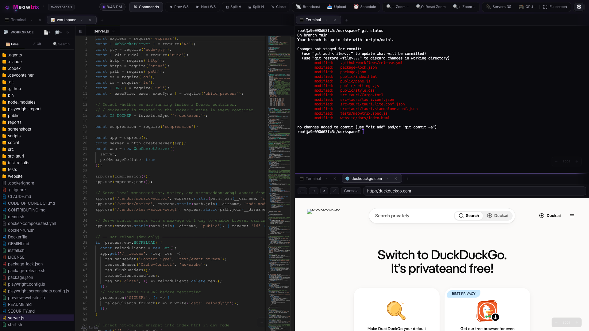
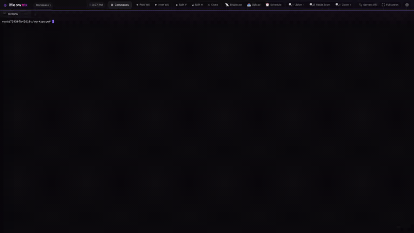
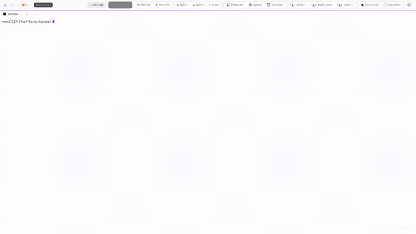
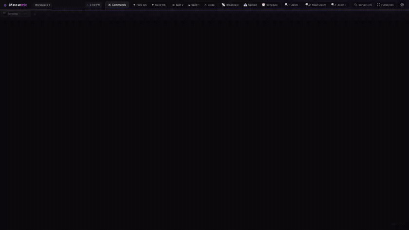
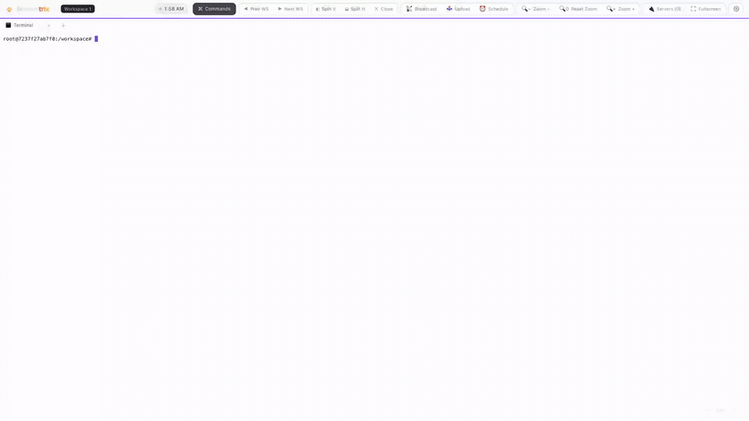
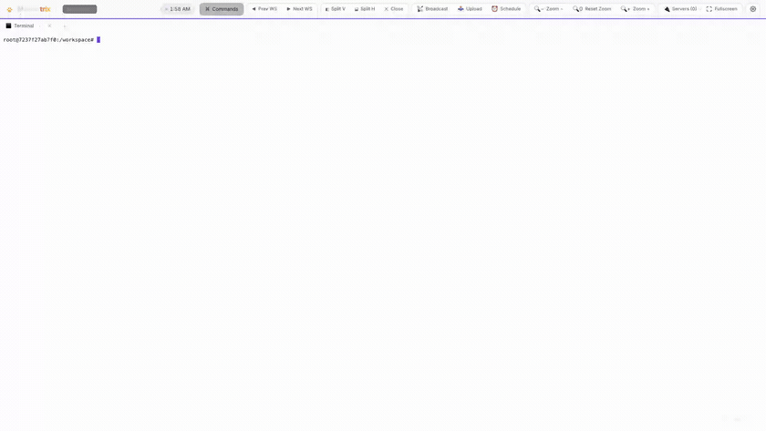
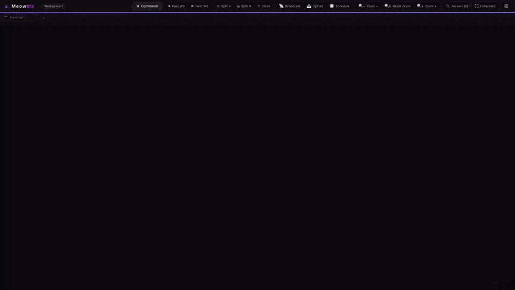

# 🐾 Meowtrix

> **Meowtrix has moved.** Development continues in
> [`tianhaoz95/hejitech-apps`](https://github.com/tianhaoz95/hejitech-apps/tree/main/projects/meowtrix)
> (`projects/meowtrix`), with its full history; releases are tagged `meowtrix-v<version>` there and
> the newest build is always on the [`meowtrix-latest`](https://github.com/tianhaoz95/hejitech-apps/releases/tag/meowtrix-latest)
> release. Installed copies update there by themselves. This repository is archived. Install:
> `curl -fsSL https://raw.githubusercontent.com/tianhaoz95/hejitech-apps/main/projects/meowtrix/install.sh | bash` ·
> Site: https://tianhaoz95.github.io/hejitech-apps/meowtrix/site/

[](https://github.com/tianhaoz95/meowtrix/actions/workflows/deploy-pages.yml)
[](https://github.com/tianhaoz95/meowtrix/actions/workflows/release.yml)
[](https://github.com/tianhaoz95/meowtrix/actions/workflows/e2e.yml)

Remote vibe engineering tool — a browser-based workspace with tiling split panes, each pane holding tabs: PTY-backed terminals (local or SSH), browsers, a Monaco code editor, and review tabs for your coding agents. Run it on a host machine and reach it from any browser on your network (or anywhere via a tunnel), or use the macOS desktop app; shells live on the server, so refreshes, device switches, and network blips don't kill your work.

**[Website & docs](https://tianhaoz95.github.io/meowtrix/)** · **[Live demo](https://tianhaoz95.github.io/meowtrix/demo/?demo)** · **[User guide](https://tianhaoz95.github.io/meowtrix/docs/)** · **[Developer docs](https://tianhaoz95.github.io/meowtrix/dev/)**



## Features

- **Tiling panes & tabs** — split vertically or horizontally, drag dividers to resize; each pane holds multiple tabs. Four **workspaces** each keep their own layout (`⌘←` / `⌘→` or `⌘⌥1`–`4` to switch)
  
  

- **Persistent terminals** — full PTY-backed shells via xterm.js that outlive the connection; refresh or reconnect and they reattach with replayed scrollback. Search the scrollback with `⌘F`; open **SSH tabs** straight to a host from your `~/.ssh/config`
  
  

- **Embedded browser panes** — built-in browser with a server-side proxy that strips frame-blocking headers so otherwise un-embeddable pages render in a pane. The proxy keeps a persistent, domain-aware cookie jar (so sign-ins stick across subdomains and restarts) and tunnels pages' WebSockets. In the **desktop app**, browser tabs are real native webviews instead — no proxy, sites run on their own origins

  

- **Host Browser tabs** — a real Chromium running on the host, streamed into a tab (works from any device, including phones). Sites see a normal browser: Google sign-in, OAuth popups, WebSockets and downloads work (passkeys can't reach it — sites fall back to their other sign-in methods), and the signed-in profile lives on the host so it follows you between devices. Agents can screenshot and read these tabs (`mtx browser`, MCP `host_browser_*`)
- **Code editor tabs** — Monaco (VS Code) editor with file tree sidebar; features side-by-side live **Markdown Preview** (with toggle & quick copy for code blocks) and live **HTML Preview** in browser tabs. Git repos gain a **Source Control** panel (stage/unstage, side-by-side diffs, commit, push/pull) with **AI-powered commit message generation**.
  
  

- **CoDesign review tabs** — review a living HTML design spec with your agent. The agent writes `.codesign/spec.html` and runs `mtx review`; a CoDesign tab opens beside its terminal, where you preview the design in desktop/tablet/mobile frames, inspect sizes, type and colors, and drop comment pins on elements. Then press **Send feedback** (the agent gets your comments with element selectors) or **Approve & sign off**. Works with any CLI agent (Claude Code, Codex, Gemini, …) and needs no MCP setup. The spec runs in a sandboxed iframe, and review state lives in `.codesign/review.json`, so it survives restarts and can be committed.

- **AI Agent tabs** — a built-in coding agent with a plan/diff view, running on a local model, Ollama, or any OpenAI-compatible API; switch between autonomous and supervised (confirm each tool action) modes

- **Scheduled Enter presses (⏰)** — queue an `Enter` key press for later (delay or clock time) to run commands automatically, e.g. when an agent usage quota resets. Timers live server-side next to the PTY to survive page reloads and disconnects.
  
  

- **On-device AI Chat Pet (🐾)** — chat with Mochi, a customizable wandering desktop companion (choose from 12 animal faces) powered locally via Chrome's on-device LLM (Gemini Nano via Prompt API).
- **Keystroke Combo FX** — level up your typing with streak rewards: particle bursts, screen shake, edge glow, and heat-tinted combo readouts.
- **Self-updates** — background git check notifies you of updates via an in-app banner; trigger a pull and clean server restart directly from the UI. After an update, a **What's new** sheet walks through the new features, with bug fixes on a page of their own
- **Desktop app (macOS)** — Meowtrix in its own window, with native webview browser tabs and a **quick overlay** that drops the workspace down from the notch with a global shortcut (`⌥Space` by default), even over full-screen apps. Comes in two editions: *Standalone* bundles its own server; *Lite* is a small shell that connects to a Meowtrix server already running on the Mac. See [Desktop app](#3-desktop-app-macos)
- **File transfer & dev-server detection** — upload files to the host (`⌘⇧U`, drop them onto the editor's file tree, or paste a screenshot into a terminal) and pull files back with `mtx download`; when a new dev server starts listening, a toast offers to open it
- **`mtx` host helper** — `mtx download <file>` pushes a host file to your browser as a download; `mtx code <dir>` opens that directory in a code-editor tab; `mtx spec` / `mtx review` / `mtx feedback` / `mtx resolve` drive the CoDesign review loop
- **Agent tools (`mtx` + MCP)** — agents in a Meowtrix terminal can show you their work instead of handing you links: `mtx open <url>` opens a page in a browser tab beside the agent's terminal and reuses the tab for a local dev server (`--host` for a Host Browser tab); `mtx browser list|shot|text` lets the agent see the host-browser page you're looking at; `mtx edit <file>:<line>` opens code in the editor; `mtx layout` describes the panes; `mtx notify <msg>` toasts and flags the agent's tab. None of them steal your focus. `mtx mcp` serves the same actions as MCP tools; register it with Claude Code via `mtx mcp --install`
- **Cross-device sessions** — server-coordinated single active session; move the whole workspace between browsers and devices and your layout follows
- **Command palette** — `⌘K` (or `Ctrl/⌘+Shift+P`) fuzzy launcher for every action: split, new tab, switch tabs/panes, broadcast, themes, settings, schedules, self-update
  
  

- **Localhost-first** — the manual launcher binds to `127.0.0.1` by default so it's not exposed to your network; opt into LAN/remote access explicitly (a `--service` install binds `0.0.0.0`) — see [Network access](#network-access--security)
- **Broadcast input** — mirror keystrokes to every visible terminal at once (like tmux `synchronize-panes`)
- **Mobile-ready** — on-screen key bar with sticky Ctrl/Alt/Cmd modifiers and double-tap autocomplete
- **Linear Slate & OLED themes** — Precision engineered developer tool aesthetic in light and dark modes (or follow the system), plus Retina OLED jet black and a high-contrast light theme; terminals are themed to match
  
  

- **Built for flaky links and heavy output** — bursts of terminal output are batched, divider drags resize shells once per pause, and background scans pause while no window is visible (each switchable in Settings → Performance)
- **No build step** — plain ES scripts served directly; settings & layout persist to `~/.meowtrix/`


## Prerequisites

Meowtrix runs on the **host machine** (macOS or Linux) — you only need a browser on the devices you connect from. 

Depending on your preferred installation method, the prerequisites differ:

- **Zero-Dependency Install (Recommended):**
  - No dependencies required. The installer automatically downloads the pre-packaged Node.js runtime and compiled native modules for your platform.
- **Source-Based Install:**
  - **Node.js 18+** and **npm** — runs the server
  - **git** — clones the repository
  - **A C/C++ build toolchain** — to compile `node-pty` natively:
    - **macOS:** Xcode Command Line Tools (`xcode-select --install`)
    - **Linux:** `build-essential` (or `gcc`/`make`) and `python3`

> The `--service` auto-start mode is supported on macOS (launchd) and Linux (systemd) only. Windows is not supported by the installer.

## Install

### 1. Zero-Dependency Binary Install (Recommended)

Run the installer:
```bash
curl -fsSL https://raw.githubusercontent.com/tianhaoz95/meowtrix/main/install.sh | bash
```
*Note: If `git` or `node` are not detected on your system, the installer will automatically fall back to downloading a precompiled release. You can force this zero-dependency binary install by passing the `--binary` flag:*
```bash
curl -fsSL https://raw.githubusercontent.com/tianhaoz95/meowtrix/main/install.sh | bash -s -- --binary
```

### 2. Source-Based Install

If you prefer to compile from source and have Node.js, git, and a C/C++ toolchain installed:
```bash
# Clone the repository manually
git clone https://github.com/tianhaoz95/meowtrix.git ~/.meowtrix/app
cd ~/.meowtrix/app

# Run the installer from source
./install.sh
```

### 3. Desktop app (macOS)

Download the `.dmg` from the [latest release](https://github.com/tianhaoz95/meowtrix/releases/latest) (Apple Silicon, signed and notarized):

- **Meowtrix Standalone** (~55MB) — self-contained: bundles Node and the server, so there's nothing else to install. It uses a Meowtrix server already running on port 9123 if there is one, otherwise it starts its own.
- **Meowtrix Lite** (~5MB) — a lightweight shell for a Meowtrix server installed with options 1 or 2 above; it connects to the server on port 9123.

Both check for app updates themselves (or use **Check for Updates…** in the menu-bar tray). The quick overlay's shortcut and look are under Settings → Quick Overlay.

---

Then run:

```bash
meowtrix
```

And open `http://localhost:9123` in your browser.

### Running with Docker (Isolated Testing)

For testing Meowtrix without affecting a running production instance or to run in an isolated environment, you can run it inside a Docker container on a random, untaken host port:

```bash
./docker-run.sh
```

Or via npm:

```bash
npm run docker
```

This will automatically:
1. Locate a random untaken port on your host.
2. Build the Docker container image.
3. Start the container in interactive mode.
4. Mount the current directory to `/workspace` inside the container as the terminal's workspace.
5. Create an isolated Docker volume (`meowtrix-dev-settings`) to persist settings/session layout without modifying your host's production `~/.meowtrix/` config.
6. Automatically open the browser to the new testing instance.

You can also pass a custom workspace path to mount:
```bash
./docker-run.sh /path/to/another/folder
```

### Install as a service (auto-start on login)

```bash
curl -fsSL https://raw.githubusercontent.com/tianhaoz95/meowtrix/main/install.sh | bash -s -- --service
```

Uses **launchd** on macOS and **systemd** on Linux. Meowtrix will start automatically on login and restart if it crashes.

> ⚠️ Unlike the manual launcher (localhost-only), a `--service` install binds to **`0.0.0.0` (all interfaces)** by default — the assumption being that an auto-starting service is meant to be reached from other devices. Since there's no built-in auth, only do this on a network you trust, or front it with your own auth/firewall. To keep a service install localhost-only, edit the unit's `HOST` env var to `127.0.0.1` (in `~/Library/LaunchAgents/com.meowtrix.plist` or `~/.config/systemd/user/meowtrix.service`) and reload it.

#### Stopping & starting the service

Once installed with `--service`, control it with the native service manager. Stopping the service kills all in-memory PTYs (running shells).

**macOS (launchd):**

```bash
launchctl unload ~/Library/LaunchAgents/com.meowtrix.plist   # stop (and disable auto-start)
launchctl load   ~/Library/LaunchAgents/com.meowtrix.plist   # start (and re-enable auto-start)
```

To check status: `launchctl list | grep com.meowtrix`. Logs: `~/.meowtrix/meowtrix.log`.

**Linux (systemd):**

```bash
systemctl --user stop    meowtrix   # stop
systemctl --user start   meowtrix   # start
systemctl --user restart meowtrix   # restart
systemctl --user status  meowtrix   # check status
```

To stop it from auto-starting on login: `systemctl --user disable meowtrix` (and `enable` to turn it back on). Logs: `journalctl --user -u meowtrix -f`.

### Update

Meowtrix checks for updates in the background and shows a banner when one is available; **Update & restart** (also in the command palette) pulls it and, for a `--service` install, restarts the server. Restarting ends running shells, so you pick the moment. You can also re-run the installer, which pulls the latest into `~/.meowtrix/app`:

```bash
curl -fsSL https://raw.githubusercontent.com/tianhaoz95/meowtrix/main/install.sh | bash
```

### Uninstall

To fully uninstall Meowtrix, stop the service (if running), remove the service configuration, and delete the installation files.

**macOS:**

```bash
# Stop and remove the launchd service
launchctl unload ~/Library/LaunchAgents/com.meowtrix.plist 2>/dev/null || true
rm -f ~/Library/LaunchAgents/com.meowtrix.plist

# Remove the launcher and configuration folder
rm -f ~/.local/bin/meowtrix
rm -rf ~/.meowtrix
```

**Linux:**

```bash
# Stop and disable the systemd service
systemctl --user stop meowtrix 2>/dev/null || true
systemctl --user disable meowtrix 2>/dev/null || true
rm -f ~/.config/systemd/user/meowtrix.service
systemctl --user daemon-reload

# Remove the launcher and configuration folder
rm -f ~/.local/bin/meowtrix
rm -rf ~/.meowtrix
```

## Quick start (from source)

```bash
npm install      # node-pty compiles natively
npm start        # serves on PORT (default 9123)
```

Then open `http://localhost:9123` in your browser.

## Network access & security

Meowtrix hands whoever can reach it a **real shell on the host**, so by default it binds to **`127.0.0.1` (localhost only)** — reachable from the host itself but invisible to the rest of the network. (Exception: a `--service` install binds to `0.0.0.0` by default, since an auto-starting service is typically meant to be reached remotely — see [Install as a service](#install-as-a-service-auto-start-on-login).) There are two safe ways to use it remotely:

**1. SSH tunnel (recommended).** Leave the default localhost binding and forward the port over SSH from your client machine:

```bash
ssh -L 9123:localhost:9123 <user>@<host>
# then open http://localhost:9123 in your local browser
```

This keeps Meowtrix off the network entirely — only your authenticated SSH session can reach it. Tunnels like `ngrok http 9123` also work with the default binding, since they connect to localhost on the host.

**2. Bind to the network.** To reach Meowtrix directly from other devices on a **trusted** LAN, bind to all interfaces:

```bash
meowtrix --network         # or: meowtrix --host 0.0.0.0
# from source:
HOST=0.0.0.0 npm start
```

Then open `http://<host-ip>:9123` from any device. You can also bind to one specific interface with `--host <addr>` or the `HOST` env var.

> ⚠️ `--network` exposes a shell to anyone who can reach the port — there is no built-in authentication. Only do this on a network you trust, or front it with your own auth/firewall.

### Dev mode (hot reload)

```bash
./start.sh       # nodemon + browser hot-reload
```

### Desktop app (Tauri v2)

```bash
npm run tauri:dev               # run Meowtrix Lite against the local dev server
npm run tauri:dev:standalone    # run Meowtrix Standalone
npm run tauri:build             # build both editions (or tauri:build:lite / tauri:build:standalone)
```

Releases are cut with `./scripts/cut_release.sh vX.Y.Z`; CI builds, signs, notarizes and attaches the DMGs.

### Packaging a Release

To package Meowtrix into a zero-dependency portable archive for the current host OS & architecture:

```bash
./package-release.sh
```

This script automatically downloads a standalone Node.js binary, installs production dependencies, compiles native modules (`node-pty`), and outputs a `.tar.gz` bundle into the `dist/` directory.


### Containerized development (Dev Container)

A [Dev Container](https://containers.dev) config lives in `.devcontainer/`. Open the repo in VS Code (or GitHub Codespaces) and "Reopen in Container" — it builds on a Debian-based Node image with the toolchain `node-pty` needs, runs `npm install`, preinstalls both the Claude Code CLI (`claude`) and Antigravity CLI (`agy`) into `~/.local/bin` (and adds it to the `PATH`), configures aliases (`ccyolo` for `claude --dangerously-skip-permissions` and `agyyolo` for `agy --dangerously-skip-permissions` in `~/.bashrc`), and forwards port `9123`. Then run `npm start` (or `./start.sh`) inside the container.

## Try the demo (no install)

Meowtrix can run entirely in the browser with no server — terminals become an in-browser JavaScript REPL, and layout/settings persist to `localStorage`.

- **Online:** [tianhaoz95.github.io/meowtrix/demo/?demo](https://tianhaoz95.github.io/meowtrix/demo/?demo)
- **Locally:** `./demo.sh` (serves the static demo and opens it)

In demo mode the browser pane loads URLs directly (no proxy), so only sites that allow embedding will appear.

## Keyboard shortcuts

Use `⌘` on macOS or `Ctrl` elsewhere.

| Shortcut | Action |
|---|---|
| `⌘K` / `Ctrl+Shift+P` | Open the command palette |
| `⌘/` | Show all keyboard shortcuts |
| `⌘\` | Split vertical |
| `⌘-` | Split horizontal |
| `⌘T` | New tab (pick the type) |
| `⌘W` | Close tab |
| `⌘⇧W` | Close pane |
| `⌘←` / `⌘→` | Previous / next workspace |
| `⌘⌥1`–`4` | Jump to workspace 1–4 |
| `⌘F` | Search the terminal |
| `⌘⇧=` / `⌘⇧-` / `⌘⇧0` | Zoom the active tab in / out / reset |
| `⌘⇧U` | Upload files to the host |
| `⌘⇧S` | Schedule an Enter press |
| `⌘,` | Settings |
| `⌘B` (macOS) / `Ctrl+Shift+B` | Toggle broadcast input |
| `⌥Space` | Summon the quick overlay (macOS desktop app, global) |

The **command palette** (`⌘K`, or `Ctrl/⌘+Shift+P`) is a fuzzy launcher for every action — splitting, new tabs of any type, switching tabs and panes, broadcast input, theme switching, settings, schedules, updates, and What's new. Type to filter, arrow keys to move, `Enter` to run.

Double-click (or double-tap) inside a terminal to send `Tab` for autocomplete.

## Settings

Settings are saved to `~/.meowtrix/settings.json` on the host machine; the workspace layout is saved to `~/.meowtrix/session.json`. The embedded browser's cookies live in `~/.meowtrix/proxy-cookies.json` and the Host Browser's profile in `~/.meowtrix/host-browser-profile/` — both hold real sign-in sessions, so treat them like passwords.

| Setting | Default |
|---|---|
| Theme | Auto (follows the system: Linear Slate dark/light) |
| Terminal font size | 13 |
| Terminal font | Cascadia Code |
| Terminal renderer | WebGL (GPU accelerated, sharpest) |
| Scrollback | 10,000 lines |
| Shell | `$SHELL` (falls back to `/bin/bash`) |
| Browser homepage | blank (shows a start page) |
| Browser tabs (desktop app) | Native webview (or the embedded proxy) |
| Host browser executable | auto-detect Chrome / Chromium / Edge / Brave, else Chrome for Testing |
| Host browser stream quality | Balanced |
| Check for updates in the background | On |
| Performance: batch terminal output / debounce resizes | On / On |
| Performance: dev-server port scan | Every 10 s |
| Quick overlay shortcut (macOS desktop app) | `⌥Space` |
| Chat pet / Keystroke Combo FX / GPU monitor (NVIDIA) | Off (opt-in) |

### Which browser tab should I use?

| | Browser (web) | Browser (desktop app) | Host Browser |
|---|---|---|---|
| Engine | iframe behind the server proxy | native webview on your machine | Chromium on the host, streamed |
| Sign-ins | kept in the proxy's cookie jar | your OS browser store | host profile (`~/.meowtrix/host-browser-profile`), follows you across devices |
| Google sign-in / OAuth popups | often blocked | ✓ (popups open as tabs) | ✓ |
| Passkeys | ✗ | not verified | ✗ (declined, so sites offer other methods) |
| `localhost` means | the host | your machine (same as the host for local installs) | the host |
| Feel | native | native | video-like (JPEG stream), slight latency |

The Host Browser needs a Chromium-based browser on the host; if none is found the tab offers to download Chrome for Testing (~150MB) via Playwright.

## How it works

A single `server.js` hosts the static frontend, the settings/session REST API, and a WebSocket that multiplexes PTY sessions; PTYs are kept in memory and outlive WebSocket connections so reconnects are non-destructive. The frontend is plain global-scope ES scripts under `public/` (no bundler). See the [developer docs](https://tianhaoz95.github.io/meowtrix/dev/) and `CLAUDE.md` for the full architecture.
